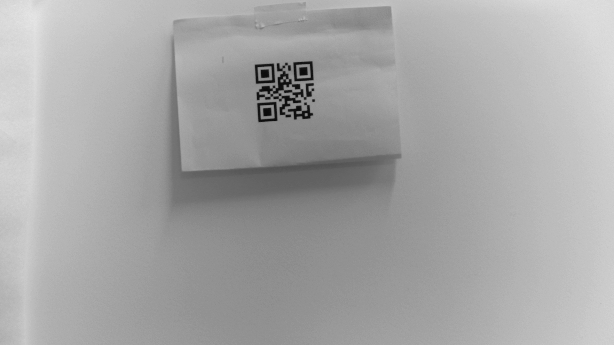
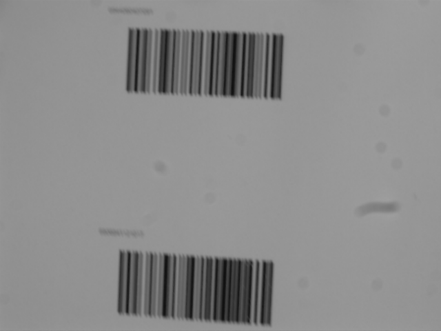

# RoboCup Medical Robot — Vision Subsystem

Vision and result-publication code for a RoboCup medical-service ("medicine rounds") robot,
written for the 2026 competition season. The robot has to read a **QR code at the nursing
station** to learn which beds to visit in which order, then read a **Code128 barcode** on the
medication box at each bed and report what it found.

Those are two different optical problems — one long-range, high-contrast, square; one
close-range, thin-striped, easily blurred — so the robot uses **two independent cameras and two
independent decoders** instead of trying to make one camera do both:

| Channel | Camera | Decoder | Transport | Payload on the wire |
|---|---|---|---|---|
| Route QR | USB UVC camera on the host (Linux V4L2 / Windows DirectShow) | ZXing-C++ on the host (`zxingcpp`) | TCP client, continuous | `1 3\n` (ASCII, one line per accepted frame) |
| Bedside barcode | OpenMV Cam H7 Plus (STM32H743 + OV5640) | Code128 decoder on the board | USB virtual COM port (VCP) | barcode text + CRLF, or RCD1 binary frames |

This repository is the personal part of that work: **the two vision channels, their serial and
TCP output, and the host-side glue that logs and publishes the decoded results**. Vehicle
navigation, ROS 2 nodes, chassis/motor control and whole-robot task scheduling live in the
team's ROS project and are deliberately not included here.

**Scope warning up front:** nothing in this repository reads a real paper code by itself. Every
test here is a computer-side check of parsing, framing, confirmation logic and failure handling.



*QR channel: a 1920x1080 frame from the host USB camera (`qr_latest.png` of a bench run). The
decoded payload is sent to the TCP receiver as one line.*



*Barcode channel: a 640x480 grayscale VGA frame grabbed by the H7 board over its own USB
protocol, two Code128 samples on one sheet.*

---

## 1. Data flow

```
              +---------------------------- host (Linux/Windows) ----------------------------+
              |                                                                             |
 USB UVC      |  host/qr_tcp.py            host/app.py + host/scan.py                       |
 camera ----->|  decode QR (ZXing-C++)     decode + log + select + optional preview          |
              |        |                          |                                         |
              |        | TCP "1 3\n"              | local HTTP (127.0.0.1:8765)             |
              |        v                          v                                         |
              |  team receiver (TCP server)   /v1/route, /v1/state  -> team ROS project     |
              +-----------------------------------------------------------------------------+
                                   ^
                                   | USB VCP (text lines or RCD1 frames)
              +--------------------+--------------------------------------------------------+
              |  OpenMV Cam H7 Plus: VGA grayscale, one Code128 decode per frame            |
              +-----------------------------------------------------------------------------+
```

Two rules keep the two channels from stepping on each other, and they are the main design
decisions in this code:

1. **The QR channel never waits for an acknowledgement.** A valid code in the current frame is
   sent immediately; an empty frame sends nothing; a broken connection is retried with a
   one-second cool-down and **old results are never replayed**. A repeated observation therefore
   looks like a repeated line on the wire, and the receiver is expected to treat the first
   accepted line as the task input.
2. **The barcode channel only ever emits barcode text.** No log lines, no status strings, no
   traceback text and no separator lines share the payload stream. If the board raises, it turns
   the red LED on and stops instead of writing the error where a barcode is expected.

### 1.1 QR payload mapping

The four legal nursing-station payloads are `11`, `13`, `31`, `33`. Digit 1 is the first bed,
digit 2 is the first medication box; the second stop is the mirror image (`4 - digit`). This is
the only place the mapping exists — `firmware/qr_scanner.py::parse_qr` is reused by the host
(`host/mission.py`) so the two sides cannot drift apart.

| QR payload | First stop (bed, box) | Second stop (bed, box) | Bytes on TCP |
|---|---|---|---|
| `11` | 1, 1 | 3, 3 | `1 1\n` |
| `13` | 1, 3 | 3, 1 | `1 3\n` |
| `31` | 3, 1 | 1, 3 | `3 1\n` |
| `33` | 3, 3 | 1, 1 | `3 3\n` |

Anything else is reported as `unexpected_qr_payload` and is not sent. Payloads are never
trimmed, padded or guessed.

### 1.2 Barcode text protocol (payload mode)

`firmware/h7_bar_usb.py` writes `payload + "\r\n"` per decoded code and nothing else.

* Several codes in one frame produce several lines, in decoder order.
* Short writes are handled: a partially accepted buffer is retried from the exact offset.
* On disconnect the pending buffer is dropped. After reconnection the board first writes a
  single `\n` so that a half-written line left in the host's buffer is terminated instead of
  being glued to the next payload.
* The host opens the VCP device, enables DTR, reads with a timeout, splits on LF and strips CR.
  USB reads may split or merge lines, so the host must buffer.

### 1.3 RCD1 binary result protocol (framed mode)

When the H7 does the barcode decoding and reports richer results, `host/result_transport.py`
speaks a small framed protocol instead of plain lines:

| Field | Type | Meaning |
|---|---|---|
| magic | `4s` = `RCD1` | frame marker |
| size | `uint32` | JSON body length, 1..65536 |
| crc | `uint32` | CRC-32 of the body |
| body | JSON | `protocol`, `boot`, `seq`, `records[]`, `errors{}`, `barcode_like`, `board_ms` |

The host sends a 4-byte command per request — `SCAN`, `BARS` (barcode phase), or `PICQ` /
`PICB` when one original frame is requested — then validates the header, the CRC, the record
types and the appearance hint before accepting the frame. Two conditions abort the run instead
of silently continuing: a body that does not parse as a result, and a **boot id change or a
non-increasing sequence number**, which means the board restarted or repeated a frame, so a new
run must start. Requested images follow the result frame in the `RCF1` container
(`magic`, `seq`, `width`, `height`, `length`, `crc32`, then raw GRAY8 bytes, `wire.py`); a
sequence mismatch between result and image discards both.

### 1.4 Local HTTP bridge

`host/team_api.py` exposes a read-only view of the mission state on `127.0.0.1` so a process on
the same vehicle can poll it:

* `GET /v1/route` — `schema_version`, `run_id`, `ready`, `plan` (the two stops)
* `GET /v1/state` — the full state snapshot, including per-bed candidates

It answers 404 for anything else, sets `Cache-Control: no-store`, and holds no credentials.
There is no write endpoint and no vehicle command in this repository.

---

## 2. Repository layout

```
host/                          host-side programs (run on the vehicle PC)
  qr_tcp.py                    self-contained QR -> TCP program (the shipped QR entry)
  qr_camera.py                 QR camera as a separate process, integrated with the mission state
  scan.py                      decode pipeline: image / video / board USB results -> JSONL + report
  mission.py                   two-bed candidate collection and order heuristic
  preview.py                   optional live result window (Tk), desktop only
  team_api.py                  read-only HTTP bridge described above
  result_transport.py          RCD1 framed results + reconnection logic
  wire.py                      RCF1 raw gray-frame container
  barcode_usb.py               host-side barcode decoding over a USB camera (superseded prototype)
  openart_transport.py         legacy OpenART USB debug transport, kept for history
  selftest.py                  host-level self checks (wire, decoder, USB transport doubles)
  curate_video.py              build a sample set from a screen recording
  app.py                       deployment entry: config validation, run directory, preview/headless
  config.example.json          template config for app.py
  robocup-vision.service.example  systemd unit template
firmware/                      board-side code for the OpenMV Cam H7 Plus
  main.py                      bench entry: both decoders per frame, confirmation gates, overlay
  config.py                    shared bench parameters (exposure, ROI, confirm counts)
  config_h7.py                 H7 board overrides (auto exposure/gain), merged by the builder
  qr_scanner.py                QR decode + payload meaning
  barcode_scanner.py           Code128 decode + payload validation
  result_filter.py             per-kind confirmation, re-arm, reject and wait events
  h7_bar_usb.py                payload-line output over USB VCP (raw decode only, no UART)
  h7_usb_results.py            RCD1 result frames over USB
  h7_bar_uart.py               alternative: decode and send payload lines on UART3
  h7_uart_output.py            UART3 writer (payload only, short-write aware)
  uart_output.py               older ASCII `QR,13` / `BAR,<code>` UART encoder
  scan_demo.py                 older demo entry using uart_output / result_filter
  barcode_test.py              minimal live barcode test for the IDE
  camera_preview.py            preview only: no decode, no markers, no files
  diagnostics/barcode_resolution_test.py   framesize sweep with explicit per-step logging
tools/
  build_standalone.py          merge firmware modules into one deployable file
  build_host_bundle.py         assemble the QR program and the board file into a release bundle
  compare_host_decoders.py     offline same-pixel ZXing-C++ vs desktop ZBar comparison
tests/                         all computer-side tests (see section 5)
docs/
  architecture.md              protocol and design notes, failure behaviour, iteration history
  host-decoder-comparison.md   why the host decodes with ZXing-C++ (measured comparison)
  barcode-recording-review.md  what a barcode screen recording did and did not prove
  images/                      three debug frames, no people and no identifying material
```

`firmware/main.py` is the bench entry that runs both decoders on the same undrawn frame; the
file that actually goes on the board is generated by `tools/build_standalone.py` (section 6), so
do not copy the bench entry to a competition board expecting production behaviour.

---

## 3. Host: QR channel

```sh
python3 -m venv .venv
.venv/bin/python -m pip install -r requirements.txt
# start the receiver first, then:
.venv/bin/python host/qr_tcp.py --camera /dev/video0 --host 127.0.0.1 --port 9000
```

* `--camera` accepts a Linux `/dev/...` path or a Windows numeric index; `--host` and `--port`
  are the receiver's address. Port 9000 is only an example.
* The program requests 1920x1080, 30 fps, MJPG and then prints the resolution the driver
  actually reports (`CAMERA actual=...`); `--width`, `--height`, `--fps`, `--fourcc` adjust it.
* Every accepted frame is sent, including repeats; empty frames and illegal payloads are not.
* It runs until Ctrl+C, never waits for a reply, and drops results that fail to send rather than
  queuing them.

`host/qr_camera.py` is the same idea inside the larger pipeline: the camera runs in a separate
`spawn` process so a blocking driver `read()` cannot stall the rest of the program, every raw
observation is appended to `qr_observations.jsonl`, and the first valid payload that the mission
state accepts locks the route and stops the capture process.

## 4. Host: full pipeline

Single image or recording (never opens a webcam):

```sh
.venv/bin/python host/scan.py --input frame.png --out results/run1
.venv/bin/python host/scan.py --input recording.mp4 --code BOTH --every 3 --out results/run2
```

Board results over USB, with the optional live window:

```sh
.venv/bin/python host/scan.py --usb-results /dev/ttyACM0 --preview --out results/run3
```

Each run directory receives `observations.jsonl` (every raw decode, including rejected and
multi-code frames), `frames.jsonl` (the per-frame record with timings and mission state),
`summary.json`, `report.html` (decoded frames with their payloads) and up to 100 evidence PNGs.
Saved evidence is the original gray crop — markers are never drawn into it. Frame counts are
explicitly not success rates; the summary says so in its own `note` field.

Deployment entry with a config file:

```sh
cp host/config.example.json host/config.json   # then edit port / output_dir / preset_qr
.venv/bin/python host/app.py --config host/config.json --check   # validate without opening USB
.venv/bin/python host/app.py --config host/config.json           # continuous, headless
```

`app.py` validates the config (required keys `port`, `preset_qr`, `preview`, `output_dir`;
optional `qr_camera`, `api_port`), refuses a second instance with an OS-level lock, creates a
fresh timestamped run directory per start (a new process is a new mission — yesterday's result
is never reused), and turns `SIGINT`/`SIGTERM` into a clean stop when no window is open.

## 5. Tests

```sh
.venv/bin/python -m unittest discover -s tests -v
```

79 tests, all computer-side. They cover:

* **Wire formats and framing** — RCD1 header/CRC/length rejection, RCF1 image container with
  fragmented reads, boot-id and sequence checks, image/result sequence mismatch.
* **Transport behaviour** — real loopback TCP with a server that never acknowledges, short USB
  writes, back-pressure, disconnect during a pending line, no replay after reconnect.
* **Decoding** — real ZXing encodes of QR and Code128 fed through the decoder, blank frames,
  multiple codes, wrong symbology, illegal payloads.
* **Confirmation logic** — confirm counts, re-arm after a code disappears, long gaps not counted
  as consecutive confirmation, ambiguity of two same-kind codes, one kind failing while the
  other still works both decoders before any drawing happens.
* **Mission state** — all four route payloads, candidate counting, the gap-plus-difference rule
  for moving to the second bed, reconnect keeping candidates while clearing the gap clue.
* **Bundles** — the generated single-file board program is executed in a stub `sensor`/`pyb`
  environment and must behave exactly like the modules it was built from.

A second, broader self-check sits next to the host code it exercises, because it drives the real
pipeline rather than isolated functions:

```sh
cd host && python selftest.py     # 13 checks: real decoder on synthetic frames, RCF1 through a
                                 # fragmented stream, USB packet cancellation, report generation
```

What these tests cannot tell you: whether a real camera sees a real printed code, whether the H7
USB stack delivers every frame on real hardware, or whether the robot completes a run. Those
need the physical setup.

## 6. Board: H7 barcode channel

Prebuilt bundles are committed under `firmware/deploy/`, so flashing needs no Python on the
operator's machine. For normal operation copy `firmware/deploy/h7_bar_usb.py` to the board as
`main.py`; see [`firmware/deploy/README.md`](firmware/deploy/README.md) for what each bundle is and
for the flashing order.

To rebuild them from source:

```sh
python3 tools/build_standalone.py
```

This writes the bench bundles into `build/` (`openmv_scan_test.py`, `h7_scan_test.py`,
`h7_scan_uart.py`, `openmv_scan_demo.py`, `openmv_scan_uart.py`) and the RCD1 result bundle
`build/h7_usb_results.py`. For the payload-line firmware used with the TCP/line receiver, build
the USB payload variant explicitly:

```sh
python3 -c "import sys; sys.path.insert(0,'tools'); import build_standalone as b; print(b.build_usb_results(payload_usb=True))"
# -> build/h7_bar_usb.py : save as main.py in the root of the board's USB drive
```

Deployment, in order: back up whatever `main.py` is already on the board, copy the generated
file in as `main.py`, eject safely, power-cycle. Use a USB cable that carries data — not a
charge-only cable, and not a USB-to-TTL adapter, because the results travel over the board's own
virtual COM port. The host must not run the board program, and the IDE must not hold the port
while the business program is reading it.

Board behaviour in payload mode: grayscale VGA, auto exposure and auto gain, **one decode call
per frame on the raw image** (no binary retry, no resolution sweep), barcode text out, red LED
and stop on an internal error. The bench entry `firmware/main.py` is different on purpose: it
runs QR and Code128 on the same undrawn image, gates each kind through an independent
`ResultFilter`, and only draws overlay rectangles after both decoders have finished.

`firmware/barcode_scanner.py` ships a six-payload sample list (`BAR_PAYLOADS`) used as a bench
reference. The production path calls it with `strict_samples=False`, so **any** Code128 payload
is accepted and the list is only a convenience label for printed samples.

## 7. Hardware prerequisites

* **Host** — Linux or Windows, Python 3.10+, one USB UVC camera for the QR channel. Linux needs
  read access to the V4L2 device (usually the `video` group); the VCP device needs `dialout`.
  A desktop session is required only for `--preview`.
* **Camera settings the code assumes** — MJPG at 1920x1080/30 fps for the QR channel (the driver
  may silently give less; the program prints what it got), grayscale VGA with automatic exposure
  and gain for the board.
* **Board** — OpenMV Cam H7 Plus (STM32H743, OV5640), MicroPython firmware with `pyb.USB_VCP`,
  and a data-capable USB cable. A manual-focus lens is expected; focus is a mechanical setting,
  not something this code controls.
* **No extra adapter** for the payload mode: results leave over the board's USB VCP. The UART
  variant (`h7_bar_uart.py` + `h7_uart_output.py`) needs UART3 TX/RX plus a common ground, and
  is kept as an alternative, not the default.
* **Not required** by this repository: ROS, a GPU, or network access. The HTTP bridge is bound to
  loopback.

## 8. Iteration history (why the code looks like this)

* **OpenMV in-line scanning → host USB camera for the QR channel.** The board had to point at a
  code, capture, decode and transmit with a single small sensor and limited memory, and its
  preview/IDE path kept interfering with transfers. Moving the QR decode to the host bought a
  bigger sensor, real resolution, a better decoder and an independently restartable process; the
  board kept the close-range barcode job it is good at.
* **Single lock plus acknowledgement → send as soon as a result is ready.** The earlier flow
  waited for an `OK` reply before accepting the next frame, which turned one slow receiver into a
  stalled camera. The shipped behaviour is continuous: current-frame results only, no lock, no
  ACK, no replay.
* **Board-side Code128 decoding over plain payload lines.** Early versions sent images to the
  host, then used UART adapters, then a framed binary result protocol. The final simple path is
  native decoding on the H7 with payload text over its own USB VCP, which removed the adapter,
  the image transfer and most of the failure modes at once.

## My role

I designed and wrote the vision subsystem in this repository:

* the QR channel — USB camera handling, ZXing-C++ decoding, payload interpretation and the
  continuous TCP output;
* the barcode channel — H7 board programming (VGA grayscale capture, Code128 decoding, USB VCP
  and the RCD1 result framing), plus the UART alternative kept for comparison;
* the host-side pipeline that logs raw observations, publishes results, and exposes the read-only
  local HTTP bridge that the team's software can poll.

Not mine, and not in this repository: navigation and localisation, the ROS 2 nodes that consume
these results, bed association as part of a whole-vehicle task graph, chassis and motor control,
and the competition scheduling logic. The two-stop order produced here is an order heuristic
published as `provisional`; the vehicle side decides what to do with it.
